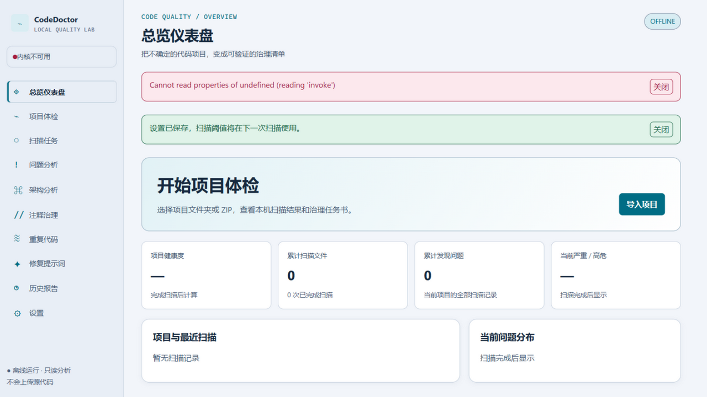

# CodeDoctor

[简体中文](README.md) · **English** · [日本語](README.ja.md)

[](https://github.com/yuchen0x1/CodeDoctor/actions/workflows/ci.yml)
[](https://github.com/yuchen0x1/CodeDoctor/releases/latest)
[](LICENSE)

CodeDoctor is an offline-first code quality inspection tool. The Windows desktop workbench focuses on evidence review, history snapshots, and governance prompts; the Linux CLI targets terminals and CI, scanning local directories or ZIP archives and producing machine-readable reports. Scanning always runs locally: no network access, no executing project scripts, no uploading source code.



> Note: linked documents are currently available in Chinese only.

## Features

- **Offline scanning**: import local directories or ZIP archives; jobs support pause, resume, and cancel, can be re-run with the original settings after interruption, and reuse validated rule caches.
- **Evidence review**: filter issues by file, language, module, type, or severity; expand evidence and jump to the source line. Suspected credential lines are masked in previews and reports.
- **Seven-dimension scoring**: readability, structure, maintainability, complexity, duplication, architecture, and security/risk; dimensions without evidence are honestly reported as "not assessed".
- **Architecture view**: static dependencies, dependency cycles, fan-in/fan-out, and duplicated-code relations, with evidence line numbers preserved.
- **History snapshots**: results are saved to a local SQLite database; compare two snapshots for new, resolved, and persistent issues plus score changes.
- **Governance prompts**: full, focused, and targeted modes, optionally based on a completed baseline of the same project; copy or save as Markdown/TXT.
- **Report export**: JSON, Markdown, TXT, HTML, and SARIF 2.1.0; the CLI supports severity-gated exit codes.
- **Optional analyzers**: built-in analysis only by default; a locally installed Ruff can be enabled as an enhancement.

## Latest release

### 0.2.3 (2026-11-21)

SARIF export gains rule indexes and completion markers, report-dialog and scan-failure diagnostics races are fixed, credential masking coverage is extended, and the release pipeline adds version exclusivity. Full changes: [release notes](docs/releases/release-notes.md) and [Release v0.2.3](https://github.com/yuchen0x1/CodeDoctor/releases/tag/v0.2.3).

## Getting started

### Download and install

Download the latest version from [Releases](https://github.com/yuchen0x1/CodeDoctor/releases/latest) and verify it with the bundled `SHA256SUMS.txt`:

| Platform | Download | Notes |
| --- | --- | --- |
| Windows x64 | `CodeDoctor_0.2.3_x64-setup.exe` or `CodeDoctor_0.2.3_x64_en-US.msi` | Per-user installation via the setup wizard; installed builds can verify and apply signed in-app updates |
| Windows x64 | `codedoctor.exe` | Portable build, run directly |
| Linux x64 | `CodeDoctor_0.2.3_linux_x64-cli.tar.gz` | For terminals and CI; no GUI or WebView required |

The desktop app requires the Microsoft Edge WebView2 Runtime; data is written only to the current user's local scan database. See the [privacy and data boundary notes](docs/privacy.md) and the [installation and update guide](docs/engineering/updating.md).

### CLI example

```bash
codedoctor-cli scan ./project --format sarif --fail-on high > report.sarif
```

Exit code `0` means the report was generated and passed the gate, `1` means the command or scan failed, and `2` means the report was generated and issues reached the severity threshold.

### Build from source

Run `pnpm tauri build --ci` in this repository; Windows x64 artifacts are located in `src-tauri/target/release`:

| Artifact | Usage |
| --- | --- |
| `bundle/nsis/CodeDoctor_<version>_x64-setup.exe` | Double-click and follow the per-user setup wizard |
| `bundle/msi/CodeDoctor_<version>_x64_en-US.msi` | Double-click to install via Windows Installer |
| `codedoctor.exe` | Run directly, no installation |

## Local development

Prerequisites: Node.js, pnpm, Rust stable, plus the Windows WebView2/build tooling required by Tauri 2.

```powershell
pnpm install --frozen-lockfile
pnpm dev
pnpm typecheck
pnpm test
pnpm build
cargo fmt --manifest-path src-tauri/Cargo.toml -- --check
cargo clippy --manifest-path src-tauri/Cargo.toml --locked --all-targets
cargo test --manifest-path src-tauri/Cargo.toml --locked
pnpm tauri dev
pnpm tauri build --ci
```

`CARGO_HOME` can point to a local cache directory for Rust dependencies; the project does not need network access to download analyzers or project dependencies.

## Typical workflow

1. On the project page, open the native folder or ZIP picker, drag in a directory or ZIP, or paste an absolute path. The import preview shows languages, frameworks, file counts, line counts, depth, and configuration manifests.
2. In Settings, save scan thresholds, extra excluded directories, and local Ruff preferences. Scan jobs support pause, resume, and cancel.
3. In issue analysis, filter by file, language, module, type, or severity, expand evidence with the matching source lines, or export the filtered issues as JSON. The architecture graph shows static dependencies, cycles, and duplication.
4. In governance prompts, choose full, focused, or targeted mode, optionally with a completed baseline of the same project for incremental task lists.
5. In history, compare two completed snapshots of the same project, or export JSON, Markdown, TXT, HTML, and SARIF reports.

## Scoring and reports

Scoring covers readability, structure, maintainability, complexity, duplication, architecture, and security/risk. Each dimension is weighted by actual detection evidence; dimensions without evidence are shown as "not assessed". Duplication is reported as the proportion of files with evidence-backed duplicates, and technical debt is estimated from the remediation effort ranges of found issues. History comparison shows new, resolved, and persistent issues, location and severity changes, and score and coverage differences.

## Language coverage

Parsing coverage has three tiers: `ast` (real tree-sitter syntax trees), `structural` (per-script-block parsing for Vue/Svelte/HTML), and `lexical` (line/comment statistics only). Syntax-level languages are Python, JavaScript/JSX, TypeScript/TSX, Java, Go, Rust, C, C++, C#, and PHP; Kotlin, Swift, Shell, CSS, SQL, JSON, YAML, XML, Dockerfile, and others are currently lexical-only. The full matrix and metric definitions are in the [language capability matrix](docs/language-capability-matrix.md).

## Optional local analyzers

Scanning uses built-in analysis only by default. A locally installed Ruff can be enabled; execution limits for the other adapters and tools not yet integrated are described in [local analyzers](docs/analyzers.md).

## Documentation

| Document | Contents |
| --- | --- |
| [Release notes](docs/releases/release-notes.md) | Detailed changes per version |
| [Language capability matrix](docs/language-capability-matrix.md) | Parsing coverage tiers and metric definitions |
| [Local analyzers](docs/analyzers.md) | External tool adapter status and limits |
| [Privacy and data boundaries](docs/privacy.md) | Data storage, credential masking, known limits |
| [Contributing](CONTRIBUTING.md) / [Security](SECURITY.md) | Contribution requirements and private vulnerability reporting |
| [Architecture and baseline](docs/engineering/baseline.md) · [Platform decisions](docs/engineering/platforms.md) · [Maintenance and release](docs/engineering/maintenance.md) · [Competitor research](docs/engineering/research.md) · [Installation and updates](docs/engineering/updating.md) | Engineering decisions and maintenance guides |

## FAQ

- Scanning, comparison, and export work offline; only checking for software updates reaches GitHub.
- After the original project moves, saved history reports remain viewable; re-scanning requires importing an available directory or ZIP.
- The app UI is currently Chinese-only; English and Japanese documentation are available via the language switch at the top of this page. Built-in UI internationalization (i18n) is on the roadmap.

## Roadmap

- Maintain the Windows install/update chain, real-world distribution verification for the Linux CLI, and standard report interoperability.
- Built-in UI internationalization (i18n) support.
- Candidate platforms are adopted based on independent acceptance results.

## Contributing

PRs are welcome following the [contributing guide](CONTRIBUTING.md); report security issues via [private security advisories](SECURITY.md). The project is released under the [MIT license](LICENSE).

[Latest release](https://github.com/yuchen0x1/CodeDoctor/releases/latest) · [Report an issue](https://github.com/yuchen0x1/CodeDoctor/issues/new/choose)
