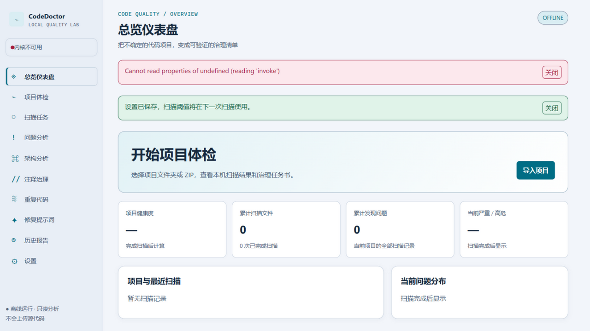

# CodeDoctor

[简体中文](README.md) · [English](README.en.md) · **日本語**

[](https://github.com/yuchen0x1/CodeDoctor/actions/workflows/ci.yml)
[](https://github.com/yuchen0x1/CodeDoctor/releases/latest)
[](LICENSE)

CodeDoctor はオフライン優先のコード品質診断ツールです。Windows デスクトップ版はエビデンスの確認、履歴スナップショット、改善タスク（ガバナンスプロンプト）の作成に特化し、Linux CLI はターミナルと CI 向けにローカルのディレクトリや ZIP をスキャンし、機械可読なレポートを出力します。スキャンはすべてローカルで完結し、ネットワーク接続・プロジェクトスクリプトの実行・ソースコードのアップロードは行いません。



> 注: リンク先のドキュメントは現在 中国語 のみです。

## 主な機能

- **オフライン スキャン**: ローカルのディレクトリや ZIP を取り込み、一時停止・再開・キャンセルに対応。中断後も元の設定で再実行でき、検証済みのルール キャッシュを再利用します。
- **エビデンス レビュー**: 問題をファイル・言語・モジュール・種別・重要度で絞り込み、エビデンスを展開してソース行に移動できます。疑わしい認証情報の行はプレビューとレポートでマスクされます。
- **7 項目のスコアリング**: 可読性・構造・保守性・複雑度・重複コード・アーキテクチャ・セキュリティ/リスク。エビデンスがない項目は「未評価」と正直に表示します。
- **アーキテクチャ ビュー**: 静的依存関係、循環依存、ファンイン/ファンアウト、重複コードの関係を、エビデンスの行番号付きで表示します。
- **履歴スナップショット**: スキャン結果をローカルの SQLite に保存し、2 つのスナップショットを比較して新規・解決済み・継続中の問題やスコア変化を確認できます。
- **ガバナンス プロンプト**: 全面・重点・ピンポイントの 3 モード。同一プロジェクトの完了済みベースラインを選んで増分タスクを生成し、Markdown/TXT としてコピーまたは保存できます。
- **レポート出力**: JSON、Markdown、TXT、HTML、SARIF 2.1.0。CLI は重要度ゲートによる終了コードに対応します。
- **オプションのアナライザー**: 既定では内蔵分析のみ。ローカルにインストール済みの Ruff を有効化できます。

## 最新リリース

### 0.2.3（2026-11-21）

SARIF 出力にルール インデックスと完了マークを追加し、レポート ダイアログとスキャン失敗診断の競合を修正、認証情報マスクのカバレッジを拡張、リリース パイプラインにバージョン排他制御を追加しました。全変更は[リリース ノート](docs/releases/release-notes.md)と [Release v0.2.3](https://github.com/yuchen0x1/CodeDoctor/releases/tag/v0.2.3) を参照してください。

## はじめに

### ダウンロードとインストール

最新版を [Releases](https://github.com/yuchen0x1/CodeDoctor/releases/latest) からダウンロードし、同梱の `SHA256SUMS.txt` で整合性を確認してください:

| プラットフォーム | ダウンロード | 説明 |
| --- | --- | --- |
| Windows x64 | `CodeDoctor_0.2.3_x64-setup.exe` または `CodeDoctor_0.2.3_x64_en-US.msi` | ウィザードに従って現在のユーザーへインストール。インストール版はアプリ内で署名付き更新を確認・適用できます |
| Windows x64 | `codedoctor.exe` | インストール不要でそのまま実行 |
| Linux x64 | `CodeDoctor_0.2.3_linux_x64-cli.tar.gz` | ターミナルと CI 向け。GUI や WebView は不要 |

デスクトップ アプリには Microsoft Edge WebView2 Runtime が必要です。データは現在のユーザーのローカル スキャン データベースにのみ書き込まれます。詳細は[プライバシーとデータ境界](docs/privacy.md)と[インストールと更新](docs/engineering/updating.md)を参照してください。

### CLI の例

```bash
codedoctor-cli scan ./project --format sarif --fail-on high > report.sarif
```

終了コードは `0` がレポート生成かつゲート通過、`1` がコマンドまたはスキャンの失敗、`2` がレポート生成かつ重要度しきい値に達する問題の検出を意味します。

### ソースからビルド

このリポジトリで `pnpm tauri build --ci` を実行すると、Windows x64 の成果物は `src-tauri/target/release` に出力されます:

| 成果物 | 用法 |
| --- | --- |
| `bundle/nsis/CodeDoctor_<version>_x64-setup.exe` | ダブルクリックでウィザードに従い現在のユーザーへインストール |
| `bundle/msi/CodeDoctor_<version>_x64_en-US.msi` | ダブルクリックで Windows Installer 経由でインストール |
| `codedoctor.exe` | そのまま実行（インストール不要） |

## ローカル開発

前提要件: Node.js、pnpm、Rust stable、および Tauri 2 が要求する Windows 用 WebView2/ビルド ツール。

```powershell
pnpm install --frozen-lockfile
pnpm dev
pnpm typecheck
pnpm test
pnpm build
cargo fmt --manifest-path src-tauri/Cargo.toml -- --check
cargo clippy --manifest-path src-tauri/Cargo.toml --locked --all-targets
cargo test --manifest-path src-tauri/Cargo.toml --locked
pnpm tauri dev
pnpm tauri build --ci
```

`CARGO_HOME` でローカルの Rust 依存キャッシュを指定できます。アナライザーやプロジェクト依存のダウンロードにネットワーク接続は必要ありません。

## 典型的なワークフロー

1. プロジェクト画面でネイティブのフォルダー/ZIP 選択ダイアログを開くか、ディレクトリや ZIP をドラッグするか、絶対パスを貼り付けます。取り込みプレビューには言語・フレームワーク・ファイル数・行数・深さ・設定ファイル一覧が表示されます。
2. 設定画面でスキャンしきい値、追加の除外ディレクトリ、ローカル Ruff の設定を保存します。スキャン ジョブは一時停止・再開・キャンセルに対応します。
3. 問題分析画面でファイル・言語・モジュール・種別・重要度で絞り込み、エビデンスと対応するソース行を展開するか、絞り込んだ問題を JSON でエクスポートします。アーキテクチャ グラフで静的依存・循環・重複コードを確認できます。
4. ガバナンス プロンプトで全面・重点・ピンポイントのモードを選び、同一プロジェクトの完了済みベースラインを選択して増分タスクを生成します。
5. 履歴画面で同一プロジェクトの 2 つの完了スナップショットを比較するか、JSON・Markdown・TXT・HTML・SARIF のレポートを出力します。

## スコアリングとレポート

スコアは可読性・構造・保守性・複雑度・重複コード・アーキテクチャ・セキュリティ/リスクの 7 項目で構成され、実際の検出エビデンスに基づいて重み付けされます。エビデンスのない項目は「未評価」と表示されます。重複率はエビデンスのある重複ファイルの割合で示し、技術的負債は検出された問題の修正工数の幅から推定します。履歴比較では新規・解決済み・継続中の問題、位置と重要度の変化、スコアとカバレッジの差分を表示します。

## 言語カバレッジ

解析カバレッジは 3 段階です: `ast`（tree-sitter の構文木）、`structural`（Vue/Svelte/HTML の script ブロック単位の解析）、`lexical`（行数とコメントの統計のみ）。構文レベルの対象は Python、JavaScript/JSX、TypeScript/TSX、Java、Go、Rust、C、C++、C#、PHP です。Kotlin、Swift、Shell、CSS、SQL、JSON、YAML、XML、Dockerfile などは現在語彙（lexical）レベルです。完全なマトリクスと指標の定義は[言語能力マトリクス](docs/language-capability-matrix.md)を参照してください。

## オプションのローカル アナライザー

スキャンは既定で内蔵分析のみを使用します。インストール済みの Ruff を有効化できます。他のアダプターの実行制限や未接続のツールは[ローカル アナライザー](docs/analyzers.md)を参照してください。

## ドキュメント

| ドキュメント | 内容 |
| --- | --- |
| [リリース ノート](docs/releases/release-notes.md) | バージョンごとの変更詳細 |
| [言語能力マトリクス](docs/language-capability-matrix.md) | 解析カバレッジの段階と指標の定義 |
| [ローカル アナライザー](docs/analyzers.md) | 外部ツール アダプターの状態と制限 |
| [プライバシーとデータ境界](docs/privacy.md) | データ保存、認証情報のマスク、既知の制限 |
| [コントリビューション](CONTRIBUTING.md) / [セキュリティ](SECURITY.md) | 貢献要件と脆弱性の非公開報告 |
| [アーキテクチャとベースライン](docs/engineering/baseline.md) · [プラットフォーム判断](docs/engineering/platforms.md) · [保守とリリース](docs/engineering/maintenance.md) · [競合調査](docs/engineering/research.md) · [インストールと更新](docs/engineering/updating.md) | エンジニアリング判断と保守ガイド |

## よくある質問

- オフラインでもスキャン・比較・エクスポートが可能です。ソフトウェア更新の確認のみ GitHub への接続が必要です。
- 元のプロジェクトを移動した後でも、保存済みの履歴レポートは閲覧できます。再スキャンには利用可能なディレクトリまたは ZIP の取り込みが必要です。
- アプリ UI は現在 中国語 のみです。英語と日本語のドキュメントはこのページ上部の言語切替から利用できます。UI の多言語化（i18n）はロードマップに含まれています。

## ロードマップ

- Windows のインストール/更新経路、Linux CLI の実配信検証、標準レポートの相互運用性を維持します。
- アプリ UI の多言語化（i18n）サポート。
- 候補プラットフォームは個別の受け入れ検証結果に基づいて採用します。

## コントリビューション

[コントリビューション ガイド](CONTRIBUTING.md) に従って PR を歓迎します。セキュリティ問題は[非公開のセキュリティ報告](SECURITY.md)をご利用ください。本プロジェクトは [MIT ライセンス](LICENSE) で公開されています。

[最新リリース](https://github.com/yuchen0x1/CodeDoctor/releases/latest) · [問題の報告](https://github.com/yuchen0x1/CodeDoctor/issues/new/choose)
