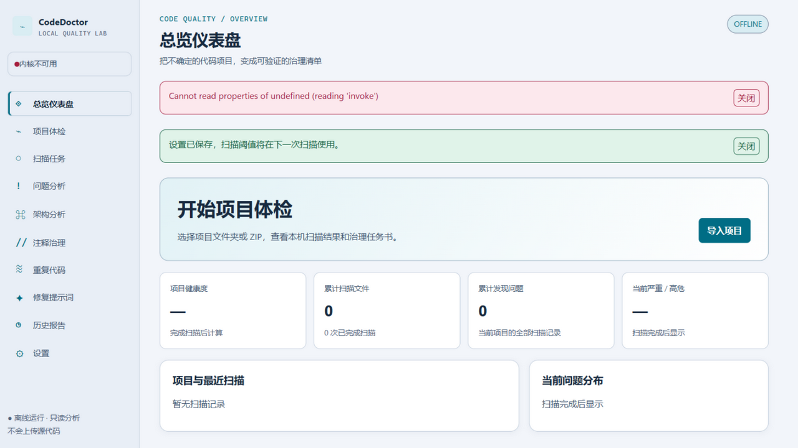

# CodeDoctor

**简体中文** · [English](README.en.md) · [日本語](README.ja.md)

[](https://github.com/yuchen0x1/CodeDoctor/actions/workflows/ci.yml)
[](https://github.com/yuchen0x1/CodeDoctor/releases/latest)
[](LICENSE)

离线优先的代码质量体检工具。Windows 桌面工作台面向证据审阅、历史快照和治理提示词；Linux CLI 面向终端和 CI，在本机扫描目录或 ZIP，输出机器可读报告。扫描全程在本机完成：不联网、不执行项目脚本、不上传源码。



## 功能特性

- **离线扫描**：导入本地目录或 ZIP，任务支持暂停、继续、取消，中断后可按原设置恢复，并复用校验通过的规则缓存。
- **证据审阅**：问题按文件、语言、模块、类型、严重度筛选，展开证据并定位到源码行；疑似凭据行在预览与报告中遮蔽。
- **七维评分**：可读性、结构、可维护性、复杂度、重复代码、架构、安全与风险；缺少证据的维度如实显示“未评估”。
- **架构视图**：静态依赖、循环依赖、扇入扇出与重复代码关系，保留证据行号。
- **历史快照**：扫描结果保存到本地 SQLite，比较两个快照的新增、已解决与持续问题及评分变化。
- **治理提示词**：全面、重点、定点三种模式，可选用同项目的已完成基线生成增量任务书，复制或保存为 Markdown、TXT。
- **报告导出**：JSON、Markdown、TXT、HTML、SARIF 2.1.0；CLI 支持按严重度门禁退出。
- **可选分析器**：默认仅用内置分析，可启用本机已安装的 Ruff 作为增强。

## 最新版本

### 0.2.3（2026-11-21）

SARIF 导出补齐规则索引与完成标记、修复报告对话框与扫描失败诊断的竞态、扩展凭据遮蔽覆盖、发布流水线增加版本互斥。完整变更见[更新记录](docs/releases/release-notes.md)与 [Release v0.2.3](https://github.com/yuchen0x1/CodeDoctor/releases/tag/v0.2.3)。

## 快速开始

### 下载安装

从 [Releases](https://github.com/yuchen0x1/CodeDoctor/releases/latest) 下载最新版本，并使用随包附带的 `SHA256SUMS.txt` 校验完整性：

| 平台 | 下载 | 说明 |
| --- | --- | --- |
| Windows x64 | `CodeDoctor_0.2.3_x64-setup.exe` 或 `CodeDoctor_0.2.3_x64_en-US.msi` | 按向导完成当前用户安装；安装版可在应用内验证并安装签名更新 |
| Windows x64 | `codedoctor.exe` | 免安装，直接运行 |
| Linux x64 | `CodeDoctor_0.2.3_linux_x64-cli.tar.gz` | 终端与 CI 使用，无需 GUI 或 WebView |

桌面应用需要 Microsoft Edge WebView2 Runtime；数据只写入当前用户的本地扫描数据库，详见[隐私与数据边界](docs/privacy.md)与[安装和更新](docs/engineering/updating.md)。

### CLI 示例

```bash
codedoctor-cli scan ./project --format sarif --fail-on high > report.sarif
```

退出码 `0` 表示报告生成并符合门禁，`1` 表示命令或扫描失败，`2` 表示报告生成且发现达到严重度门槛的问题。

### 从源码构建

在本仓库执行 `pnpm tauri build --ci` 后，Windows x64 产物位于 `src-tauri/target/release`：

| 产物 | 用法 |
| --- | --- |
| `bundle/nsis/CodeDoctor_<版本>_x64-setup.exe` | 双击，按向导完成当前用户安装 |
| `bundle/msi/CodeDoctor_<版本>_x64_en-US.msi` | 双击，通过 Windows Installer 安装 |
| `codedoctor.exe` | 直接运行，免安装 |

## 本地开发

前置要求：Node.js、pnpm、Rust stable，以及 Tauri 2 所需的 Windows WebView2/构建工具。

```powershell
pnpm install --frozen-lockfile
pnpm dev
pnpm typecheck
pnpm test
pnpm build
cargo fmt --manifest-path src-tauri/Cargo.toml -- --check
cargo clippy --manifest-path src-tauri/Cargo.toml --locked --all-targets
cargo test --manifest-path src-tauri/Cargo.toml --locked
pnpm tauri dev
pnpm tauri build --ci
```

Rust 依赖缓存可通过 `CARGO_HOME` 指向本机缓存目录；项目不需要联网下载分析器或项目依赖。

## 典型工作流

1. 在“项目体检”打开原生文件夹或 ZIP 选择器，也可拖入目录或 ZIP，或粘贴绝对路径。导入预览提供语言、框架、文件数、行数、深度和配置清单。
2. 在“设置”保存扫描阈值、额外排除目录和本机 Ruff 偏好。扫描任务支持暂停、继续和取消。
3. 在“问题分析”按文件、语言、模块、类型或严重度筛选，展开证据和对应源码行，或导出筛选后的 JSON 清单。架构图可查看静态依赖、循环和重复代码关系。
4. 在“修复提示词”选择全面、重点或定点模式，任选同项目的已完成基线以生成增量任务书。
5. 在“历史报告”比较同一项目的两个完成快照，或导出 JSON、Markdown、TXT、HTML、SARIF 报告。

## 评分与报告

评分包含可读性、结构、可维护性、复杂度、重复代码、架构、安全与风险七个维度。各维度根据实际检测证据加权，缺少证据的维度显示“未评估”。重复率按有依据的重复文件比例呈现，技术债务按已发现问题的治理工作量区间估算。历史比较显示新增、已解决、持续、位置与严重度变化，以及评分和覆盖率差异。

## 语言覆盖

解析覆盖分三个等级：`ast`（tree-sitter 语法树）、`structural`（Vue/Svelte/HTML 的 script 块分区解析）、`lexical`（词法统计）。语法级覆盖 Python、JavaScript/JSX、TypeScript/TSX、Java、Go、Rust、C、C++、C#、PHP；Kotlin、Swift、Shell、CSS、SQL、JSON、YAML、XML、Dockerfile 等当前为词法级。完整矩阵与指标口径见[语言能力矩阵](docs/language-capability-matrix.md)。

## 可选本机分析器

扫描默认仅使用内置分析。用户可启用已安装的 Ruff；其余适配器的执行限制及尚未接入的工具见[本机分析器](docs/analyzers.md)。

## 文档

| 文档 | 内容 |
| --- | --- |
| [更新记录](docs/releases/release-notes.md) | 各版本变更明细 |
| [语言能力矩阵](docs/language-capability-matrix.md) | 解析覆盖等级与指标口径 |
| [本机分析器](docs/analyzers.md) | 外部工具适配状态与限制 |
| [隐私与数据边界](docs/privacy.md) | 数据存储、凭据遮蔽与已知限制 |
| [参与贡献](CONTRIBUTING.md) / [安全报告](SECURITY.md) | 贡献要求与漏洞私密报告渠道 |
| [架构与基线](docs/engineering/baseline.md) · [平台评估](docs/engineering/platforms.md) · [维护和发布](docs/engineering/maintenance.md) · [竞品与技术研究](docs/engineering/research.md) · [安装和更新](docs/engineering/updating.md) | 工程决策与维护手册 |

## 常见问题

- 断网时可继续扫描、比较和导出；只有检查软件更新需要访问 GitHub。
- 原项目移动后，已保存的历史报告仍可查看；重新扫描需导入可用目录或 ZIP。
- 应用界面当前为中文；英文与日文文档通过页面顶部的语言切换进入。界面内建多语言（i18n）在路线图中。

## 路线图

- 维护 Windows 安装与更新链路、Linux CLI 的实际分发验证及标准报告互操作。
- 应用界面内建多语言（i18n）支持。
- 各候选平台以独立验收结果为准。

## 参与贡献

欢迎按[贡献指南](CONTRIBUTING.md)提交 PR；安全问题请使用[私密安全报告](SECURITY.md)。项目基于 [MIT 许可证](LICENSE) 发布。

[下载正式版](https://github.com/yuchen0x1/CodeDoctor/releases/latest) · [问题反馈](https://github.com/yuchen0x1/CodeDoctor/issues/new/choose)
